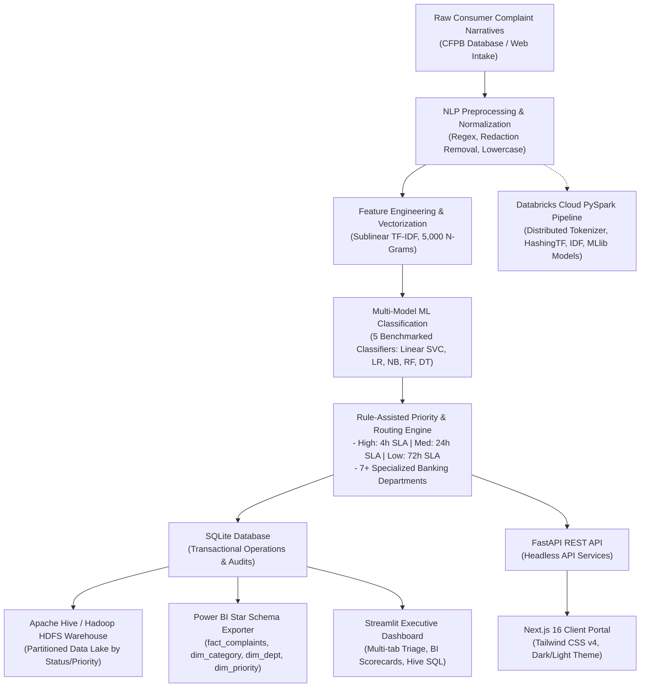

# Customer Complaint Intelligence & Big Data Analytics Platform
## Comprehensive Project Overview, Architecture, Technology Stack & Implementation Guide

---

## 📌 1. Project Introduction & Problem Statement

### 1.1 Context & Background
In the modern financial ecosystem (commercial banking, fintech, credit card networks, mortgage lenders, and investment institutions), millions of customer grievances are generated annually. In the United States alone, the **Consumer Financial Protection Bureau (CFPB)** receives and tracks hundreds of thousands of customer complaints across a wide array of financial products—including checking accounts, credit reporting errors, mortgage escrow misallocations, debt collection harassment, unauthorized credit/debit card debits, and international wire transfer failures.

### 1.2 Core Problem Statement
Traditional customer support and complaint resolution mechanisms suffer from fundamental operational defects:
1. **Manual Inefficient Triage**: Support tickets are manually reviewed by Tier-1 agents, causing significant delays (frequently exceeding statutory 15-day resolution windows under federal regulations like the Fair Credit Reporting Act (FCRA) and CFPB compliance rules).
2. **Delayed Response to Critical Security & Fraud Emergencies**: Urgent cases involving account takeover, identity theft, unauthorized wire transfers, and stolen payment cards get buried in queues alongside routine statement inquiries.
3. **Misrouting Across Operational Silos**: Tickets are frequently assigned to incorrect departments (e.g., routing an identity theft credit dispute to general billing), increasing customer frustration and turnaround time.
4. **Lack of Scalable Big Data Architecture**: Enterprise institutions handle millions of rows of unstructured complaint narratives that exceed single-machine memory capacities and require distributed architectures (Apache Spark, Apache Hive, Hadoop HDFS, and Power BI OLAP modeling).

### 1.3 Project Goal & Solution
This project delivers a production-grade, distributed **AI & Big Data Analytics Platform** that:
- Ingests real-world financial complaint narratives directly from the CFPB complaint repository.
- Performs distributed NLP text normalization, redaction stripping (`XXXX`), tokenization, and sublinear TF-IDF feature extraction.
- Classifies complaints using **5 Machine Learning benchmark models** with sub-millisecond inference latency.
- Automatically calculates urgency priority (**High / Medium / Low**) using emergency keyword triggers and SLA compliance tracking.
- Routes each ticket to one of **7+ specialized banking departments**.
- Replicates an **Apache Hive / Hadoop HDFS-compatible partitioned Data Lake** (`status={status}/priority={priority}/`).
- Exports a dimensional **Power BI Star Schema** with custom **DAX measures** for executive SLA monitoring.
- Provides a cloud-ready **Databricks PySpark MLlib distributed pipeline** for multi-million row scalability.
- Offers dual interactive frontends: an enterprise **Next.js 16 + React 19** web application and a multi-tab **Streamlit Executive Dashboard**, supported by a high-performance **FastAPI RESTful API**.

---

## 🏛️ 2. Project Metadata & Academic Profile

| Attribute | Specification |
| :--- | :--- |
| **Project Title** | Customer Complaint Sentiment Analysis and Category Analysis / Big Data Intelligence Platform |
| **Academic Course** | CSET 312: AI ML Project Course / Big Data Analytics |
| **Institution** | Bennett University (The Times Group), Greater Noida |
| **School** | School of Computer Science Engineering and Technology (SCSET) |
| **Faculty Guide** | Prof. Deepika Vatsa |
| **Team Members** | **Pranjal Chaturvedi** (Enrollment: `S24CSEU2082`)<br>**Tanmay Awal** (Enrollment: `S24CSEU2098`) |
| **Status / Phase** | Milestone 2 Completed • Production-Ready Full System Deployed |

---

## 🏗️ 3. End-to-End System Architecture

The platform follows a modular, 7-stage enterprise architectural pipeline:



### Detailed Pipeline Stages:
1. **Intake Layer**: Unstructured text complaints submitted via the Next.js web client, Streamlit portal, or CFPB bulk dataset.
2. **Text Preprocessing**: Custom regex filters scrub anonymization redactions (`XXXX`, `XX/XX/XXXX`), URLs, non-alphanumeric noise, and normalize casing.
3. **Feature Vectorization**: Sublinear TF-IDF encoding translates narratives into a 5,000-dimensional sparse feature space with unigrams and bigrams.
4. **Machine Learning Intent Classification**: Multi-class categorization assigns the grievance to its exact banking category.
5. **Urgency & Department Triage**:
   - Detects financial crime keywords (e.g., "stolen", "unauthorized", "identity theft", "foreclosure") or SLA breach conditions to elevate urgency to **High (4-hour SLA)**.
   - Dispatches tickets directly to designated teams (e.g., *Fraud & Risk Prevention*, *Card Security Team*, *Credit Dispute Bureau*).
6. **Data Lake & Warehousing**:
   - Stores operational records in SQLite.
   - Synchronizes partitioned directory files formatted for Apache Hive / Hadoop HDFS.
   - Generates Star Schema tables for Power BI.
7. **Presentation & API**:
   - Exposes RESTful endpoints via FastAPI.
   - Presents modern UI dashboards for both customers and administrators.

---

## 🛠️ 4. Complete Technology Stack & Tools Used

### 4.1 Machine Learning & Natural Language Processing
- **Python 3.10+**: Core programming language.
- **Scikit-Learn (`sklearn`)**: 
  - `TfidfVectorizer` (sublinear term frequency, `ngram_range=(1,2)`, `max_features=5000`, `min_df=2`, stop-words filtering).
  - 5 Classifiers: `SGDClassifier` (Linear SVC), `LogisticRegression`, `MultinomialNB`, `RandomForestClassifier`, `DecisionTreeClassifier`.
  - Metrics: `accuracy_score`, `precision_score`, `recall_score`, `f1_score`, `confusion_matrix`, `classification_report`.
- **NumPy & Pandas**: High-performance tabular data manipulation, feature extraction, and matrix operations.
- **SciPy**: Sparse matrix handling for high-dimensional TF-IDF vectors.
- **Matplotlib & Seaborn**: Automated chart generation for model comparison bar charts and normalized confusion matrix heatmaps.

### 4.2 Distributed Big Data & Cloud Analytics
- **Apache Spark / PySpark (`pyspark.ml`, `pyspark.sql`)**:
  - Spark NLP pipeline: `Tokenizer`, `StopWordsRemover`, `HashingTF`, `IDF`, `StringIndexer`, `VectorAssembler`.
  - PySpark MLlib distributed classifiers: `LogisticRegression`, `NaiveBayes`, `RandomForestClassifier`, `DecisionTreeClassifier`, `OneVsRest`.
  - Evaluators: `MulticlassClassificationEvaluator`.
- **Databricks Cloud Platform**: Cloud orchestration notebook (`notebooks/databricks_pyspark_pipeline.py`) supporting Delta Lake and multi-million row workloads.
- **Apache Hive & Hadoop HDFS Warehouse Simulation**:
  - Partitioned file hierarchy on disk: `warehouse/tablespace/external/hive/status={status}/priority={priority}/part-00000.csv`.
  - HiveQL DDL scripts (`scripts/hive_schema.hql`): external tables, Snappy-compressed ORC columnar storage, and analytical window function queries (`OVER (PARTITION BY ...)`).
  - Python Hive query executor (`src/hive_analytics.py`) simulating Hive analytical queries.

### 4.3 Business Intelligence & Dimensional Modeling
- **Power BI Dimensional Star Schema**:
  - `fact_complaints.csv`: Central fact table with numeric foreign keys, resolution flags, and SLA indicators.
  - `dim_category.csv`: Category dimension table.
  - `dim_department.csv`: Operational department dimension table.
  - `dim_priority.csv`: Urgency level dimension (High: 4h, Medium: 24h, Low: 72h SLA).
  - `kpi_summary.csv`: Pre-calculated KPI scorecard summary.
- **DAX (Data Analysis Expressions)**:
  - 9 production measures (`scripts/powerbi_measures.dax`) calculating Total Complaints, Resolution Rate %, Pending Backlog, High Urgency Escalation Ratio %, SLA Compliance Status (SWITCH logic), and Department Workload Share %.

### 4.4 Backend & Persistence
- **FastAPI**: Modern, asynchronous REST API with automatic OpenAPI Swagger documentation (`/docs`).
- **Uvicorn**: High-performance ASGI web server.
- **Pydantic**: Request/response schema validation and type safety.
- **SQLite Relational Database (`database.py`, `complaints.db`)**:
  - `users` table: role-based auth (admin / customer) with SHA-256 hashed passwords.
  - `complaints` table: comprehensive ticket tracking schema with audit timestamps.

### 4.5 Frontend User Interfaces
- **Next.js 16 (App Router)**:
  - React 19, TypeScript, Tailwind CSS v4.
  - Lucide React icon library.
  - Dark Mode and Light Mode dynamic theme toggle.
  - Dual portals: Customer Complaint Submission & Real-time Tracking, Admin Triage Desk with multi-filters and inline status updating.
- **Streamlit Web Application (`app.py`)**:
  - 5 Admin tabs: Complaint Triage, Power BI Analytics, Apache Hive Data Lake, ML Model Benchmarks, Admin Data Controls.
  - 2 Customer tabs: Raise Ticket, Track Complaints.

### 4.6 Reporting & Documentation
- **ReportLab PDF Engine (`generate_pdf_report.py`)**: Automated generation of publication-grade academic reports (`Milestone_2_Report.pdf`) adhering to Bennett University guidelines.

---

## 📊 5. Machine Learning Benchmark: 5 Models Evaluated

The system was evaluated on **48,990 clean customer complaints** from the CFPB database (39,102 training set, 9,888 test set) using strict train-test isolation (zero data leakage):

| Model Name | Accuracy | Precision (Macro) | Recall (Macro) | F1-Score (Macro) | F1-Score (Weighted) | Inference Latency | Train Time |
| :--- | :---: | :---: | :---: | :---: | :---: | :---: | :---: |
| **Linear Support Vector (SGD)** | **83.46%** | **0.6780** | **0.6438** | **0.6534** | **0.8299** | **< 0.01 ms** | **3.47 s** |
| **Logistic Regression** | **83.20%** | **0.6779** | **0.6348** | **0.6485** | **0.8274** | **< 0.01 ms** | **15.45 s** |
| **Multinomial Naive Bayes** | **81.05%** | **0.6446** | **0.6113** | **0.6238** | **0.8046** | **< 0.01 ms** | **0.39 s** |
| **Random Forest (60 Trees)** | **76.65%** | **0.6561** | **0.5033** | **0.5234** | **0.7467** | **0.012 ms** | **4.62 s** |
| **Decision Tree Classifier** | **71.69%** | **0.5545** | **0.5374** | **0.5443** | **0.7171** | **< 0.01 ms** | **52.45 s** |

### Why Linear Models Excel Over Tree Models for Text:
- **High-Dimensional Sparsity**: TF-IDF matrices with 5,000 features produce sparse vectors where each document contains only 50–200 active non-zero dimensions. Linear classifiers (Linear SVC and Logistic Regression) optimize hyperplanes in convex parameter spaces, separating linear combinations of features efficiently.
- **Tree Degradation**: Decision Trees and Random Forests suffer because single-feature orthogonal splits struggle to capture additive semantic combinations in sparse, high-dimensional spaces, resulting in lower recall on minority classes.

---

## 🧭 6. Priority Escalation & Department Routing Matrix

### 6.1 Priority SLAs
- **HIGH Priority (4-Hour SLA)**:
  - Triggered by emergency keywords: `fraud`, `stolen`, `unauthorized`, `without my permission`, `hacked`, `identity theft`, `victim`, `foreclosure`, `eviction`, `repossession`.
  - Triggered by regulatory SLA flags: `Timely response? == 'No'`.
  - Triggered by high monetary restitution requests: `Company response == 'Closed with monetary relief'`.
- **MEDIUM Priority (24-Hour SLA)**:
  - Routine billing disputes, unexpected service fees, loan calculation errors, processing delays.
- **LOW Priority (72-Hour SLA)**:
  - Procedural account inquiries, statement requests, promotional/reward point queries.

### 6.2 Department Dispatch Mapping
| Financial Domain / Complaint Intent | Critical Condition | Dispatched Department |
| :--- | :--- | :--- |
| Fraudulent card transactions, stolen card | Fraud flags present | **Card Security Team** |
| Account takeover, identity theft, scams | General fraud flags | **Fraud & Risk Prevention** |
| Credit reporting errors, inaccurate delinquencies | Credit repair/reporting | **Credit Dispute Bureau** |
| Debt collector harassment, FDCPA violations | Debt collection | **Debt Collection & Recoveries** |
| Mortgage escrow errors, foreclosure threats | Mortgage/housing | **Mortgage & Lending Services** |
| Delayed wire transfers, SWIFT issues, digital wallets | Transfer/digital pay | **Payments & Wire Operations** |
| Checking/savings overdrafts, fee disputes | Bank accounts | **Billing & Account Operations** |
| Personal, auto, or student loan servicing | Loans | **Consumer Lending Team** |
| General inquiries | None | **General Customer Support** |

---

## 🗄️ 7. Big Data Engineering Artifacts

### 7.1 Apache Hive / Hadoop HDFS Warehouse
- **Directory Layout**:
  ```text
  warehouse/tablespace/external/hive/
  ├── complaints_master.csv
  ├── status=In Progress/
  │   ├── priority=High/part-00000.csv
  │   └── priority=Medium/part-00000.csv
  ├── status=Pending/
  │   ├── priority=High/part-00000.csv
  │   ├── priority=Medium/part-00000.csv
  │   └── priority=Low/part-00000.csv
  └── status=Resolved/
      ├── priority=Low/part-00000.csv
      └── priority=Medium/part-00000.csv
  ```
- **HiveQL Capabilities (`scripts/hive_schema.hql`)**:
  - Columnar ORC tables with Snappy compression.
  - Department workload breakdown with percentage calculation.
  - 7-day rolling complaint volume analysis using window function `SUM(COUNT(*)) OVER (PARTITION BY department ORDER BY date ROWS BETWEEN 6 PRECEDING AND CURRENT ROW)`.
  - Pareto ranking of severe fraud incidents using `DENSE_RANK()`.

### 7.2 Power BI Star Schema & DAX
- **Dimensions & Facts**:
  - `fact_complaints.csv`: Complaint ID, text, category_id, department_id, priority_id, status, is_resolved, is_pending, is_high_risk, timestamps.
  - `dim_category.csv`, `dim_department.csv`, `dim_priority.csv`.
- **Core DAX Measures**:
  ```dax
  // Resolution Rate
  Resolution Rate % = DIVIDE([Resolved Complaints], [Total Complaints], 0) * 100

  // High Urgency Escalation Ratio
  High Urgency Ratio % = DIVIDE([High Urgency Incidents], [Total Complaints], 0) * 100

  // SLA Compliance Status
  SLA Compliance Status = 
  SWITCH(
      TRUE(),
      [Resolution Rate %] >= 80, "✅ Excellent SLA",
      [Resolution Rate %] >= 50, "⚠️ Moderate SLA",
      "🚨 Critical SLA Breach"
  )
  ```

---

## 📁 8. Repository Directory Structure

```text
complaint-system-clg/
├── app.py                             # Multi-tab Streamlit Executive Web Portal
├── database.py                        # SQLite DB manager (schema creation, auth, CRUD)
├── seed_db.py                         # Seeder script populating real-world CFPB scenarios
├── complaints.db                      # Relational SQLite database
├── generate_pdf_report.py             # ReportLab script generating Milestone 2 PDF
├── Milestone_2_Report.pdf             # Formatted academic milestone submission report
├── requirements.txt                   # Complete Python dependencies
├── run_pipeline.bat                   # 1-click batch runner for ML & Big Data pipeline
├── run.bat                            # 1-click batch launcher for Web UI
├── README.md                          # Repository overview & quick start guide
│
├── artifacts/                         # ML Model checkpoints & evaluation plots
│   ├── tfidf_vectorizer.pkl           # Fitted Scikit-Learn TF-IDF vectorizer (5,000 features)
│   ├── tfidf_metadata.json            # Vocabulary metadata & feature settings
│   ├── linear_svc_model.pkl           # Trained Linear Support Vector (SGD) model
│   ├── logistic_regression_model.pkl  # Trained Logistic Regression classifier
│   ├── naive_bayes_model.pkl          # Trained Multinomial Naive Bayes model
│   ├── random_forest_model.pkl        # Trained Random Forest classifier
│   ├── decision_tree_model.pkl        # Trained Decision Tree classifier
│   ├── model_comparison.json          # Benchmark statistics across all 5 models
│   ├── model_comparison_chart.png     # Performance comparison bar chart
│   └── confusion_matrix.png           # Normalized confusion matrix heatmap
│
├── backend/
│   └── main.py                        # FastAPI REST API (Auth, Tickets, Hive & BI triggers)
│
├── data/
│   ├── raw/                           # Raw CFPB datasets (CSV & Parquet)
│   │   ├── train.csv
│   │   ├── test.csv
│   │   ├── cfpb_train.parquet
│   │   └── cfpb_test.parquet
│   ├── processed/                     # Cleaned, enriched, and split datasets
│   │   ├── cleaned_complaints.csv
│   │   ├── train.csv
│   │   └── test.csv
│   └── powerbi/                       # Power BI Star Schema exports
│       ├── fact_complaints.csv
│       ├── dim_category.csv
│       ├── dim_department.csv
│       ├── dim_priority.csv
│       └── kpi_summary.csv
│
├── frontend/                          # Next.js 16 Web Application
│   ├── package.json                   # React 19, Lucide, Tailwind CSS dependencies
│   ├── tsconfig.json
│   └── src/
│       └── app/
│           ├── layout.tsx             # Root layout with theme provider
│           ├── globals.css            # Dark/Light theme styles
│           └── page.tsx               # Full client application (Customer & Admin views)
│
├── notebooks/
│   └── databricks_pyspark_pipeline.py # Databricks PySpark MLlib distributed cloud pipeline
│
├── scripts/
│   ├── run_pipeline.py                # Master pipeline execution script
│   ├── download_cfpb.py               # Downloader for official CFPB datasets
│   ├── hive_schema.hql                # Apache Hive DDL & analytical OLAP queries
│   └── powerbi_measures.dax           # Production DAX measures for Power BI
│
├── src/                               # Core Python source modules
│   ├── __init__.py
│   ├── preprocessing.py               # Text cleaning, regex redaction removal, tokenization
│   ├── dataset.py                     # Data ingestion, normalization, and routing rules
│   ├── eda.py                         # Exploratory Data Analysis & statistical reporting
│   ├── tfidf.py                       # Leak-free TF-IDF feature extraction
│   ├── model.py                       # Multi-model training and evaluation engine
│   ├── evaluation.py                  # Evaluation visualizer (confusion matrix & bar charts)
│   ├── predict.py                     # Multi-field prediction & routing inference engine
│   ├── hive_analytics.py              # Hive warehouse sync & SQL query runner
│   └── powerbi_export.py              # Power BI Star Schema CSV generator
│
└── warehouse/                         # Simulated HDFS / Hive Data Lake
    └── tablespace/external/hive/
        ├── complaints_master.csv
        └── status=*/priority=*/part-00000.csv
```

---

## 👥 9. Team Deliverables & Milestone Achievements

### 9.1 Completed Milestone Deliverables
- [x] **Milestone 1**: Problem formulation, dataset acquisition (CFPB), exploratory data analysis (EDA), and baseline architecture design.
- [x] **Milestone 2**:
  - NLP preprocessing pipeline with custom regex stripping of CFPB redactions (`XXXX`).
  - Leak-free TF-IDF feature vectorizer (5,000 features, unigrams & bigrams).
  - Benchmark and comparative evaluation of **5 Machine Learning Classifiers** (Linear SVC, Logistic Regression, Naive Bayes, Random Forest, Decision Tree).
  - Rule-assisted priority urgency escalation engine (High, Medium, Low) and specialized department routing logic.
  - Relational SQLite database schema and database seeder.
  - FastAPI RESTful API server.
  - Apache Hive / Hadoop HDFS partitioned storage sync and analytical query runner.
  - Power BI Star Schema generation (`fact_complaints`, `dim_*`) with DAX measures.
  - Databricks PySpark MLlib cloud pipeline.
  - Dual Web Portals: Next.js 16 (React 19 + Tailwind v4) and Streamlit Dashboard.
  - Automated ReportLab academic PDF generator (`Milestone_2_Report.pdf`).

### 9.2 Team Member Contribution Matrix
| Team Member | Enrollment | Primary Responsibilities & Deliverables |
| :--- | :--- | :--- |
| **Pranjal Chaturvedi** | `S24CSEU2082` | - Data preprocessing pipeline and noise stripping regex.<br>- Leak-free TF-IDF feature extraction engine.<br>- Training and benchmarking 5 ML models (Linear SVC, LR, NB, RF, DT).<br>- Priority rule logic and department routing engine.<br>- Databricks PySpark distributed MLlib pipeline design. |
| **Tanmay Awal** | `S24CSEU2098` | - End-to-end system architecture design.<br>- FastAPI RESTful backend development (`backend/main.py`).<br>- SQLite DB schema, migrations, and database seeding (`seed_db.py`).<br>- Next.js 16 full-stack user interface with dark/light themes.<br>- Apache Hive HDFS data lake sync and Power BI Star Schema export. |

---

## 🌍 10. Alignment to UN Sustainable Development Goals (SDGs)
- **SDG 8: Decent Work & Economic Growth**: Protects consumer financial health by expediting institutional refunds, mitigating fraudulent transaction losses, and maintaining trust in digital banking infrastructure.
- **SDG 16: Peace, Justice & Strong Institutions**: Provides transparent, auditable, and accountable dispute resolution mechanisms that prevent consumer exploitation and guarantee regulatory compliance.

---

## 🚀 11. Quickstart Guide: How to Run the Platform

### Step 1: Install Dependencies
```bash
pip install -r requirements.txt
```

### Step 2: Execute the Master Big Data & ML Pipeline (1-Click)
This single command runs the entire pipeline: dataset preprocessing, EDA, TF-IDF vectorization, 5-model training, chart generation, database seeding, Hive lake sync, and Power BI export:
```bash
python scripts/run_pipeline.py
```
*(Alternatively on Windows: double-click `run_pipeline.bat`)*

### Step 3: Launch the Streamlit Executive Dashboard
```bash
streamlit run app.py
```
Access the dashboard at `http://localhost:8501`.

**Credentials**:
- **Admin**: Username: `admin` | Password: `admin123`
- **Customer**: Username: `user` | Password: `user123`

### Step 4: Launch the FastAPI REST Server
```bash
python -m backend.main
```
Interactive Swagger API docs available at `http://127.0.0.1:8000/docs`.

### Step 5 (Optional): Launch the Next.js Web Frontend
```bash
cd frontend
npm install
npm run dev
```
Access the client portal at `http://localhost:3000`.

### Step 6: Generate Milestone PDF Report
```bash
python generate_pdf_report.py
```
Generates `Milestone_2_Report.pdf` formatted for Bennett University submission.

---
*Document Version: 3.0.0 | Milestone 2 Final Production Baseline*

